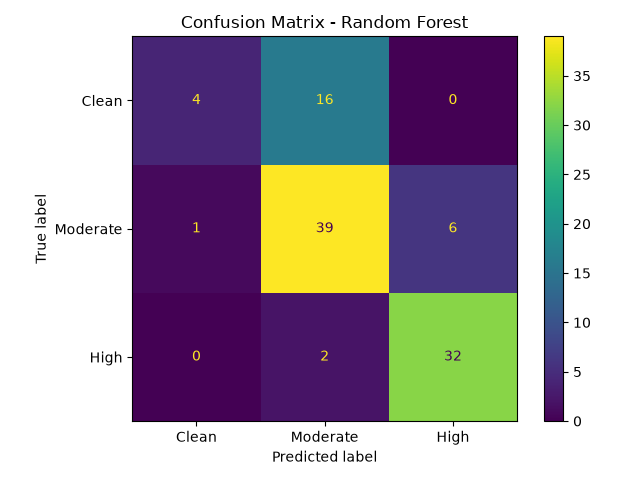

# 🌫️ Air Quality — Machine Learning Project

A machine learning project that predicts how polluted the air is from cheap gas and weather sensor readings. It sorts each reading into one of three PM2.5 risk levels: **Clean**, **Moderate**, or **High**.

The goal is simple: low-cost sensors are everywhere, but they do not measure PM2.5 directly. This project asks whether the other readings carry enough signal to flag risky air anyway.

---

## 📌 At a Glance

| Item | Detail |
| :--- | :--- |
| **Task** | Multi-class classification |
| **Input** | 9 gas and weather sensor readings |
| **Output** | `Clean`, `Moderate`, or `High` |
| **Best model** | Random Forest |
| **Accuracy** | 75% on the test split |
| **Dataset** | 500 sensor snapshots |

---

## 🧭 Why This Project Matters

Fine particulate matter (PM2.5) is one of the pollutants most strongly linked to breathing and heart problems. Reference-grade PM2.5 monitors are expensive and not available everywhere.

Cheap gas sensors are common, but they measure other things: nitrogen oxides, carbon monoxide, VOCs, temperature, and more. If those readings can predict PM2.5 risk, a cheap device could warn people when the air is likely to be unhealthy.

This project tests that idea end to end: clean the data, build a risk label, train two classifiers, evaluate them honestly, and make a single prediction from a new sensor snapshot.

---

## 📈 Results

Both models use the same stratified 80/20 split with `random_state=42`.

| Model | Accuracy | Precision (macro) | Recall (macro) | F1 (macro) | ROC-AUC (macro) |
| :--- | ---: | ---: | ---: | ---: | ---: |
| Logistic Regression | 72.0% | 63.6% | 62.5% | 59.7% | 87.7% |
| **Random Forest** | **75.0%** | **77.5%** | **66.3%** | **65.5%** | **89.9%** |

Random Forest is the stronger model overall. It catches **94%** of `High` rows and **85%** of `Moderate` rows. Most of its mistakes are on the `Clean` class, where there are only 20 test rows to learn from.



### Why not 100% accuracy?

The risk label is built from PM2.5, but PM2.5 is deliberately removed from the input features. Keeping it would leak the answer and make the model useless on a device that cannot measure PM2.5.

That leaves the model to infer the risk from sensors that only approximate it. Around the 35 µg/m³ cut-off, the sensor readings are noisy enough that `Clean` and `Moderate` overlap. A perfect score is not possible with this data, and the project does not pretend otherwise.

---

## ⚙️ How It Works

```
dataset/raw_dataset.csv
          │
          ▼
   preprocessing.py
   • remove duplicates
   • clip negative readings
   • build pm_risk from PM2.5
   • drop PM2.5 to avoid leakage
          │
          ▼
dataset/clean_dataset.csv
          │
          ├──────────────► train.py ──────► models/*.pkl
          │
          ├──────────────► evaluate.py ───► metrics + plots
          │
          └──────────────► predict.py ────► one risk label
```

### The Two Models

**Logistic Regression**
- A simple, interpretable baseline.
- Features are standardized with `StandardScaler`.
- Shows how far a linear model can go.

**Random Forest**
- 300 trees with `balanced_subsample` class weights.
- Captures non-linear sensor interactions.
- Gives the smaller `Clean` class a fairer say during training.

---

## 📊 Dataset

The dataset contains **500 sensor snapshots** with no missing values and no duplicate rows. Four readings came in slightly negative and were clipped to zero.

### Target Classes

The label comes from the measured PM2.5 value:

| Class | PM2.5 range | Rows |
| :--- | :--- | ---: |
| `Clean` | ≤ 35 µg/m³ | 100 |
| `Moderate` | 35 – 60 µg/m³ | 230 |
| `High` | > 60 µg/m³ | 170 |

The 35 µg/m³ cut-off follows the EPA 24-hour PM2.5 standard. The other two bands keep the classes reasonably balanced.

### Input Features

| Feature | Meaning |
| :--- | :--- |
| `PM10` | Coarse particulate matter |
| `NOx` | Nitrogen oxides |
| `NO2` | Nitrogen dioxide |
| `SO2` | Sulphur dioxide |
| `VOCs` | Volatile organic compounds |
| `CO` | Carbon monoxide |
| `CO2` | Carbon dioxide |
| `CH4` | Methane |
| `Temperature` | Ambient temperature |

---

## 🚀 Run It

Install the dependencies:

```bash
python -m pip install -r requirements.txt
```

Run the pipeline in order:

```bash
python preprocessing.py   # clean data and build pm_risk
python train.py           # train Logistic Regression and Random Forest
python evaluate.py        # print metrics and save plots
python predict.py         # predict one new sensor snapshot
```

The scripts find `dataset/`, `models/`, and `outputs/` relative to their own location, so they work from the project folder or from one folder above it.

### Sample Prediction

`predict.py` uses one realistic street-level reading and prints:

```text
=== AIR QUALITY PM2.5 RISK PREDICTION ===
Logistic Regression: High (68.44%)
Random Forest      : High (85.67%)
```

---

## 🧠 What Made This Project Interesting

- **Avoiding data leakage.** The target is derived from PM2.5, so PM2.5 had to be removed from the features. Without that step, the model would look impressive and be useless in the real world.
- **Class imbalance.** `Clean` is the smallest class, so macro-averaged metrics are used instead of accuracy alone.
- **A hard boundary.** Many rows sit close to the 35 µg/m³ line. When the sensors are noisy, some `Clean` and `Moderate` rows become genuinely hard to separate.
- **Honest evaluation.** The project reports where the model fails, not just the headline accuracy.

---

## 📁 Project Structure

```
air-quality-ml-project/
├── dataset/
│   ├── raw_dataset.csv          # Original sensor readings
│   └── clean_dataset.csv        # Cleaned features + pm_risk target
├── models/                      # Saved model binaries
│   ├── feature_columns.pkl
│   ├── logistic_regression.pkl
│   ├── random_forest.pkl
│   └── scaler.pkl
├── outputs/                     # Evaluation plots
│   ├── confusion_matrix_lr.png
│   └── confusion_matrix_rf.png
├── .gitignore
├── preprocessing.py             # Cleaning and target creation
├── train.py                     # Model training
├── evaluate.py                  # Metrics and plots
├── predict.py                   # Single-reading prediction
├── requirements.txt
└── README.md
```

---

## 🛠️ Tech Stack

- **Python 3.13**
- **pandas** for data cleaning
- **scikit-learn** for models and metrics
- **matplotlib** for confusion matrices
- **joblib** for saving models

On Windows, `pandas` is pinned below 3.x because newer builds are blocked by Application Control on this machine.

---

## 👤 Author

**Abdrihman Hussein**

Junior data analyst, currently working on data science and machine learning.

- GitHub: [@Abdrihman-Hussein](https://github.com/Abdrihman-Hussein)
- Portfolio: [abdrihman-hussein-portfolio.vercel.app](https://abdrihman-hussein-portfolio.vercel.app)
